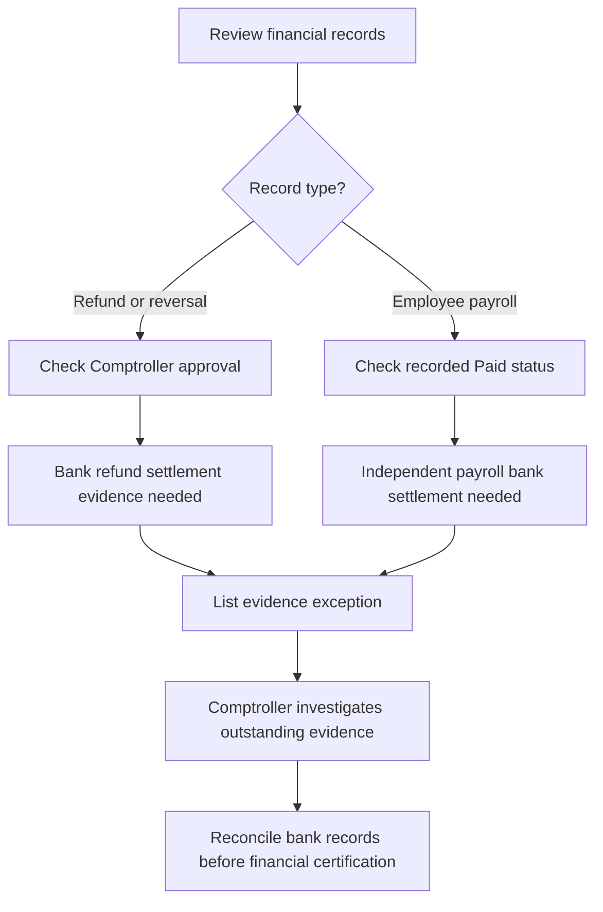

# Cash Evidence Exceptions - Refunds and Employee Payroll

Checkpoint: 1907P-4428
Status: READ-ONLY TESTED EXCEPTION REPORT, NOT OPERATIONAL

The exception report identifies approved customer refunds or
reversals and payroll marked Paid that still require independent
bank-clearing evidence before corporate cash reporting.

The review dates are operational dates, not proven settlement
dates. The report must never be presented as a bank balance or
complete Cash Flow Statement.

## Workflow

## Known limitations

This is a date-scoped exception inventory, not a complete
missing-evidence register. Employee payroll with missing Paid
timestamps, issuance-only records, unapproved refunds and
other bank transactions require further reconciliation.

No bank settlement model is introduced. No historical financial
record, operational service, approval role or payment state
is changed. CEO corporate statement approval remains off.
