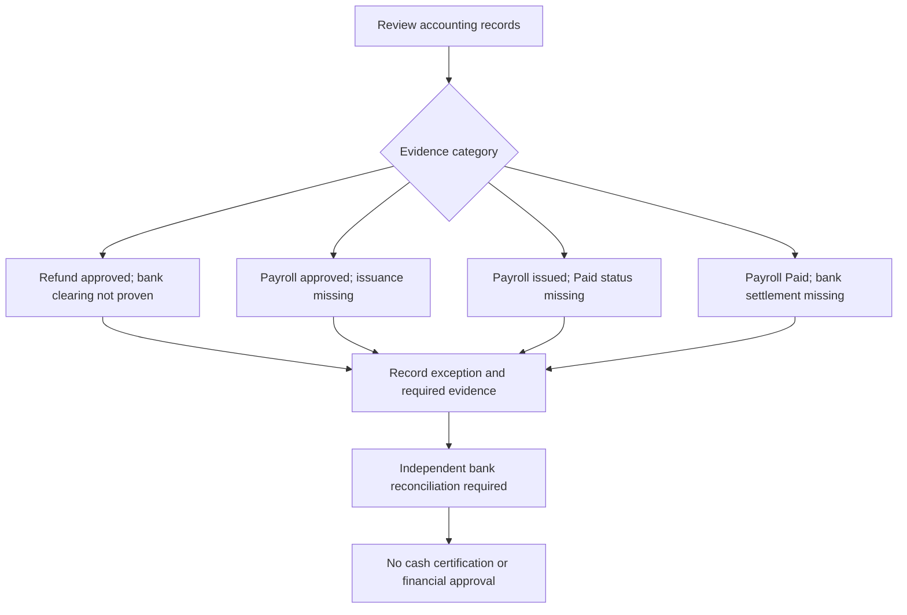

# Consolidated Cash-Evidence Exception Inventory

Checkpoint: 1907P-4431
Status: Isolated read-only preview; not operational.

This component brings together the existing refund and
employee payroll evidence exceptions and adds approved
payroll records that have not yet been issued.

## Evidence workflow

All dates are review dates, not certified bank movement dates.
An approved payroll period end is never a cash settlement date.

The exception inventory is incomplete and must not be used as
a full financial report. The existing financial services,
payment states, historical records and role permissions remain
unchanged. CEO financial approval stays disabled by default.
