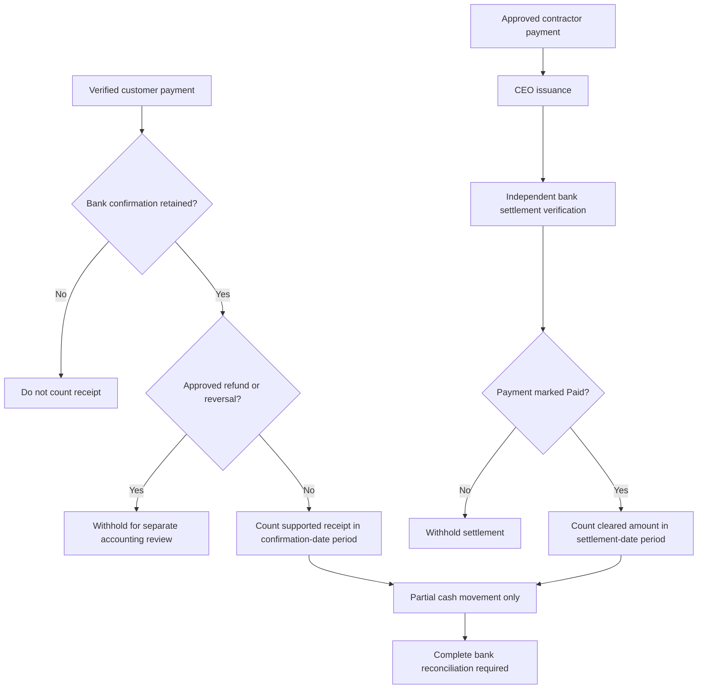

# Populated Cash Reconciliation Regression

Checkpoint: 1907P-4425
Status: Isolated database testing only; NOT operational reporting.

## Verified tests

Six tests exercise Django ORM relationships in a disposable
in-memory database using fictional customer and contractor records.

Coverage includes:
- Verified and bank-confirmed customer receipt inclusion
- Exclusion of a verified receipt without bank confirmation
- Withholding a receipt with an approved refund adjustment
- Customer bank-confirmation accounting-period boundary
- Independently verified contractor settlement and paid-state gate
- Contractor settlement accounting-period boundary

The existing customer bank confirmation and contractor four-stage
service fixtures are reused. Their normal authorization,
validation and audit rules remain in force.

## User Guide workflow

## Remaining limitations

The adapter is read-only but does not yet cover all corporate
cash movements, employee payroll settlement, cash refunds,
opening balances or a complete bank ledger.

An unconfirmed customer payment is omitted from the partial
total rather than individually listed as withheld; that
coverage gap must be resolved before financial reporting use.

Historical confirmed receipts with later adjustments are
withheld conservatively. Proper period-specific adjustment
accounting remains outstanding.

Corporate financial calculations and the CEO approval feature
remain unchanged and inactive, respectively.
