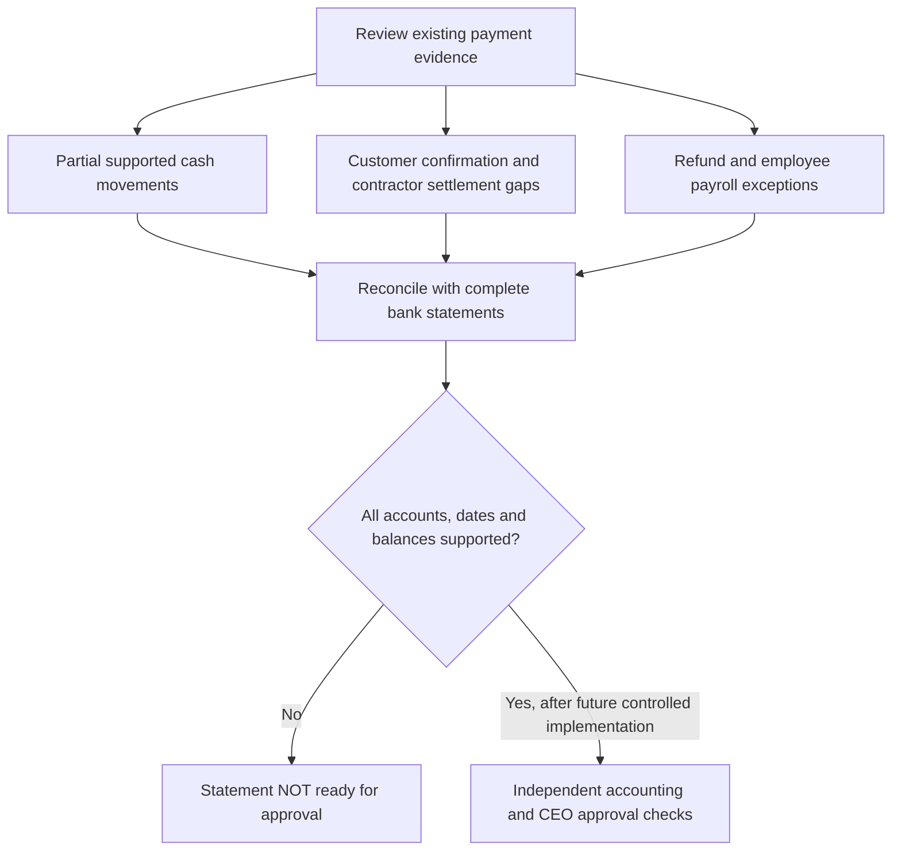

# VERIDIAN Consolidated Cash Readiness

Checkpoint: 1907P-4432
Status: Isolated read-only accounting preview, NOT operational.

The preview combines supported partial customer cash receipts,
verified contractor settlements and evidence exceptions.

It also identifies verified customer payments lacking bank
confirmation and approved contractor payments missing issuance,
settlement verification, or their final Paid transition.

## Financial review workflow

The preview does not establish a complete bank balance.
Received dates, payroll-period dates, and issuance dates are
review dates, not automatically bank settlement dates.

Even when no exceptions exist, missing opening balances,
other cash flows, refund settlements and employee payroll
settlements prevent financial-statement certification.

This code has no registered operational endpoint and cannot
activate the CEO financial statement approval feature.
No existing corporate report, payroll service, historical
record or operational database was modified.
