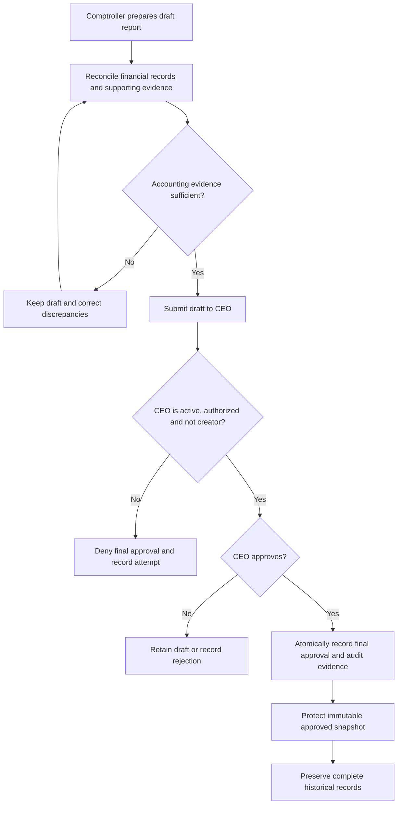

# VERIDIAN Corporate Financial Statement Approval Policy

Checkpoint: 1907P-4413
Status: BUSINESS POLICY APPROVED; IMPLEMENTATION IN PROGRESS

## Approved responsibilities

**Comptroller:** Prepares the corporate financial report, verifies
its supporting records, and creates the draft.

**CEO:** Independently reviews the draft and provides final approval.

The creator and final approver must be two distinct individuals.
Neither may approve their own report.

Each approval must have a durable audit record identifying the
report, approver, approval date, and protected report snapshot.

After approval, the report is immutable. Corrections must follow
an approved versioned correction process, preserving history.

## Approval lifecycle

## Security and implementation controls

- Backend verifies current account identity and role.
- Only the active Comptroller may create the draft.
- Only the active CEO may give final approval.
- Creator and approver must not be the same person.
- The approval transaction must fail safely if audit writing fails.
- Concurrent approvals must not cause duplicate approval records.
- Approved reports must be protected by existing database integrity
  measures and application-level controls.
- Historical approved records must not be rewritten.
- Existing documents and financial reports remain unchanged until
  explicitly authorized implementation and verification.

## Current implementation boundary

The Step 4413 policy checker uses synthetic TEST identities only.
It does not query Django, grant CEO access to an API, write audit
records, approve any report or activate financial services.

Integration with protected financial report services, serializer,
API routes, role authorization and regression tests is a separate
controlled development step.

This approved corporate statement policy is distinct from the
Manager-plus-Comptroller payroll approval workflow.
