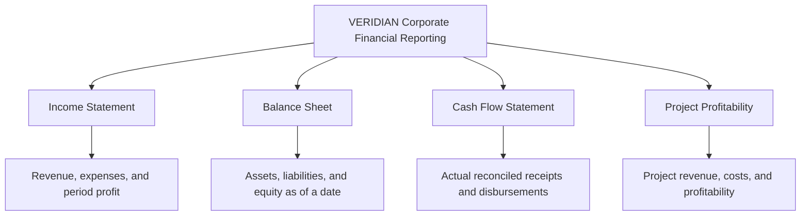
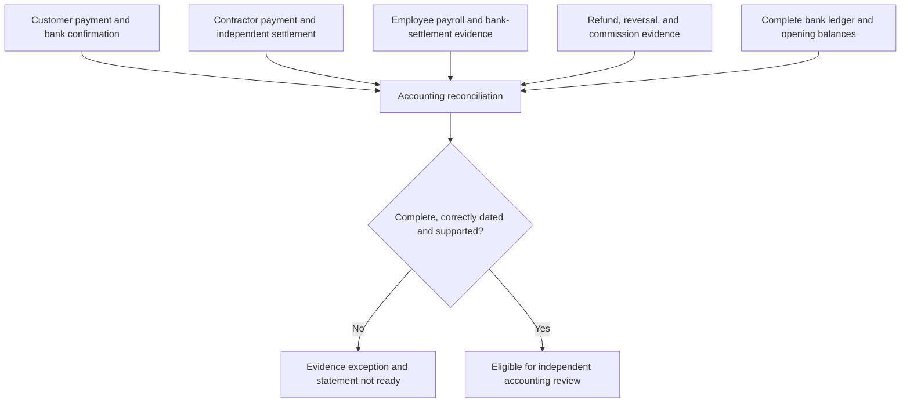
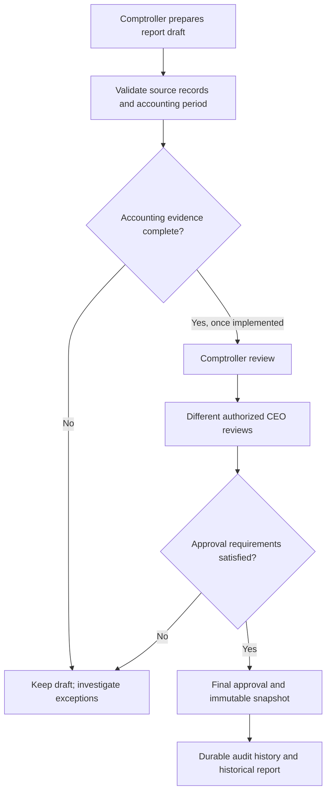
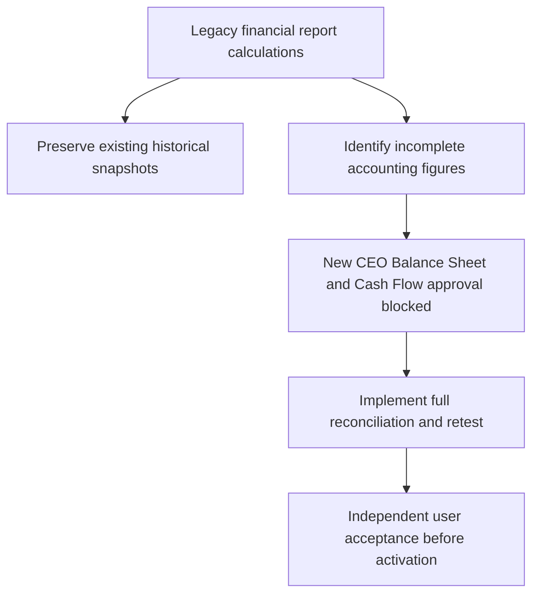

# VERIDIAN Corporate Financial Reporting - User Guide Diagrams

Company: Green Energy Contracting Corporation
Checkpoint: 1907P-4435D
Purpose: Preserve approved development concepts for future visual review.

IMPORTANT: These diagrams describe the intended design and its
accounting controls. They do not certify financial-report accuracy.
Existing statements are not yet production-ready.

## 1. Four Corporate Financial Reports

## 2. Accounting Evidence and Readiness

## 3. Draft and Independent Approval

## 4. Financial Safeguard Boundaries

## Notes for the Future User Guide

- Show the difference between approval, payment issuance, Paid
  status, and verified bank settlement.
- Explain why a receipt or approved commission is not automatically
  equivalent to cash available or cash disbursed.
- Define every accounting period, opening balance, account type,
  supporting record and exception.
- Explain the Comptroller and CEO separation of duties.
- Preserve immutable approved reports, even when future formulas
  or accounting configuration change.
- Show current implementation status separately from intended
  functionality and future production acceptance.
- Do not claim that the draft financial statements are certified.

Visual report layouts remain subject to a later user review, after
the current accounting safety development phase is complete.
