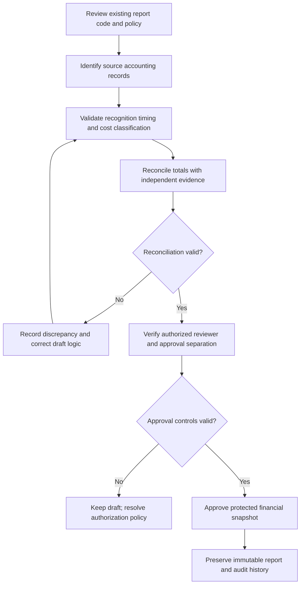

# VERIDIAN Corporate Financial Reporting Review

Checkpoint: 1907P-4409
Status: SOURCE REVIEW - NOT OPERATIONAL ACCEPTANCE

This document preserves findings from read-only inspection of
backend/core/financial_report_services.py and related authorization code.
Findings describe potential risks requiring evidence and resolution.
No actual accounting balances have been tested or certified.

## Existing report types

- Income Statement
- Balance Sheet
- Cash Flow Statement
- Project Profitability

The inspected API requires an active Comptroller account.
Approval, calculation, and historical immutability require independent
validation before production authorization.

## Financial review findings

### F01 - Income recognition and expense timing (HIGH)

The Income Statement selects approved MSRs by approved_at date and
uses snapshot total_price as revenue. Project costs are selected by
approval date. Contractor and employee expenses use paid dates, and
commissions use approval dates.

Review the intended accounting basis, recognition events and matching
rules. An approved MSR alone is not proof of a completed sale,
recognized revenue or customer payment.

### F02 - Potential double-counting of direct costs (HIGH)

The Income Statement deducts project direct costs and contractor
payment amounts. Project Profitability also includes direct
technician costs and separate contractor payments.

Determine which contractor obligations are already represented
in lead, technician, Damon, Jerry and other direct-cost categories.
Require transaction-to-project reconciliation before modifying totals.

### F03 - Incomplete balance sheet representation (CRITICAL)

The inspected Balance Sheet treats cumulative verified customer
receipts as cash and includes approved contractor and employee
liabilities. It does not calculate a complete accounting balance
sheet, bank-reconciled ending cash, or equity in the inspected snapshot.

Do not label this calculation as an approved complete Balance Sheet
until assets = liabilities + equity is demonstrated from controlled
accounting records and all applicable accounts are included.

### F04 - Commission cash-flow classification (HIGH)

The Cash Flow Statement subtracts commissions selected by
APPROVED status and approved_at date. Approval alone does not
establish an actual cash disbursement.

Separate accrued/approved commission obligations from cash
outflows supported by verified disbursement evidence.

### F05 - Project profitability uniqueness (HIGH)

The report's duplicate check is keyed to report kind and the
project creation date. Distinct projects created on one date
may collide. Verify project-specific identity and snapshot
version policy before correction.

### F06 - Creator/approver independence (HIGH)

The inspected creation and approval functions both require
the Comptroller role. The approval function does not explicitly
reject the report creator as the approving actor.

Determine and approve the corporate report approval policy,
including whether a separate person or CEO review is required.
Do not assume payroll's Manager-plus-Comptroller pattern applies
to financial statements without explicit policy confirmation.

## Financial report review process

This is the proposed review process, not a claim that all
steps currently exist in the live system.

## Safeguards and next work

1. Preserve existing financial services, database triggers and audit history.
2. Confirm accounting basis and required report approval roles.
3. Build focused isolated regression tests for confirmed issues.
4. Verify corrections without changing approved historical reports.
5. Review the financial interface before any operational release.

No live report creation, approval, API activation, production
migration, database alteration or Git operation is authorized by
this document.

## Evidence

Read-only inspection: Step 1907P-4408.
Prior source inventory: Step 1907P-4406.
User Guide diagrams: Step 1907P-4407.
