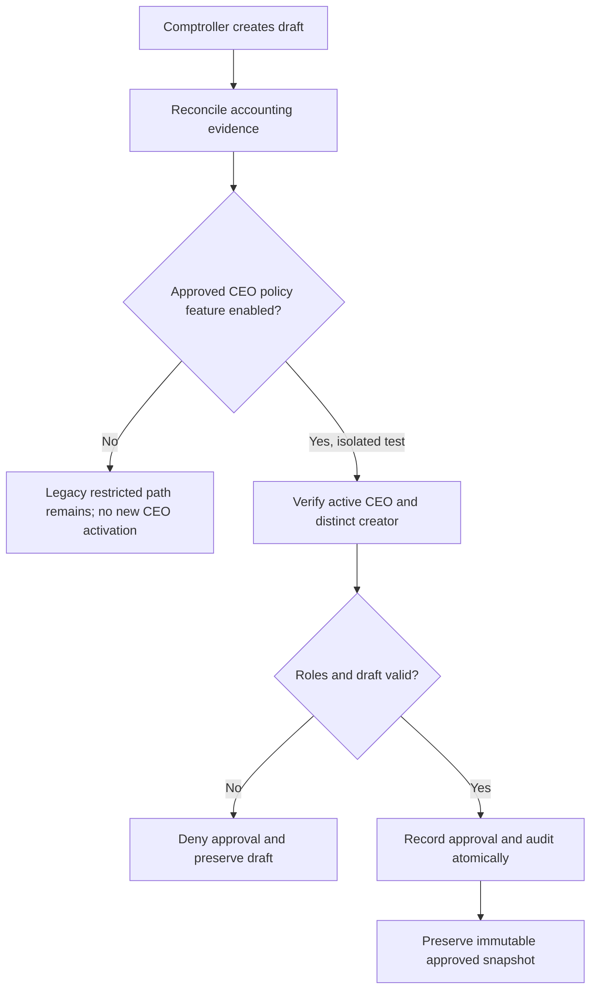

# VERIDIAN CEO Financial Approval Integration

Checkpoint: 1907P-4416
Status: Isolated integration verified; operational activation NOT approved.

## Approved corporate statement policy

The Comptroller prepares corporate financial statements.
A different, active CEO provides independent final approval.
Self-approval is forbidden. Audit history must remain durable,
and approved snapshots must remain immutable.

## Current implementation status

Step 1907P-4415J passed 20 focused CEO and legacy financial
approval tests using disposable in-memory SQLite.

The feature-gated Django service and API support CEO approval
in controlled tests. The flag
VERIDIAN_CEO_FINANCIAL_APPROVAL_ENABLED is default-off.

Step 1907P-4416 adds tests for inactive CEO accounts,
changed CEO roles, unauthorized draft creators, improper
manager approvals, and the default-off CEO API boundary.

## Approval workflow

## Still required before operational activation

- Resolve incomplete Balance Sheet and Cash Flow accounting.
- Confirm source-of-truth payment and expense evidence.
- Complete wider financial-report authorization testing.
- Verify immutable approved reports with the intended database
  safeguards and historical compatibility.
- Obtain separate approval before any feature activation.

The existing corporate report service, financial API, and role
authorization files have verified recovery copies.
No operational database or migration was modified.
