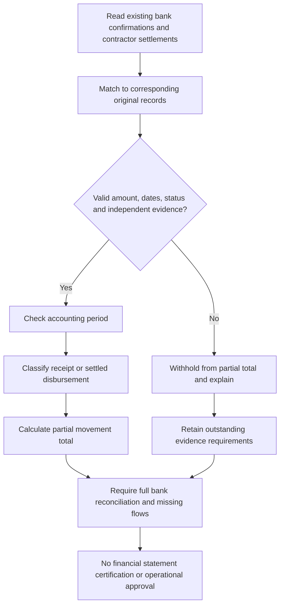

# VERIDIAN Read-Only Cash Evidence Adapter

Checkpoint: 1907P-4422
Status: ISOLATED ORM ADAPTER - NOT AN OPERATIONAL CASH FLOW REPORT

## What this component reads

Customer bank confirmations are matched to verified customer
payments. If an approved adjustment exists, the payment is
withheld pending separate adjustment and bank review.

Contractor settlement verifications are matched against payment
issuance, paid status, cleared amount, and independent verifier.

The settlement date determines the reporting period for the
contractor disbursement. The customer bank-confirmation date
determines the reporting period for the customer receipt.

## Reporting boundaries

The result is explicitly a PARTIAL cash movement total.

It does not represent complete corporate cash flow or a bank
balance. It does not yet include employee settlements, verified
refund outflows, external bank charges, financing or other
corporate receipts and expenditures.

The first isolated database test verifies read-only queries
against an empty disposable SQLite database. Individual
populated evidence cases are verified with fictional in-memory
objects. Populated ORM integration remains a future test.

## Process flow

No existing corporate financial service, API, historical report,
payment record or operational database is modified by this step.
The approved CEO financial-report approval feature remains off.
