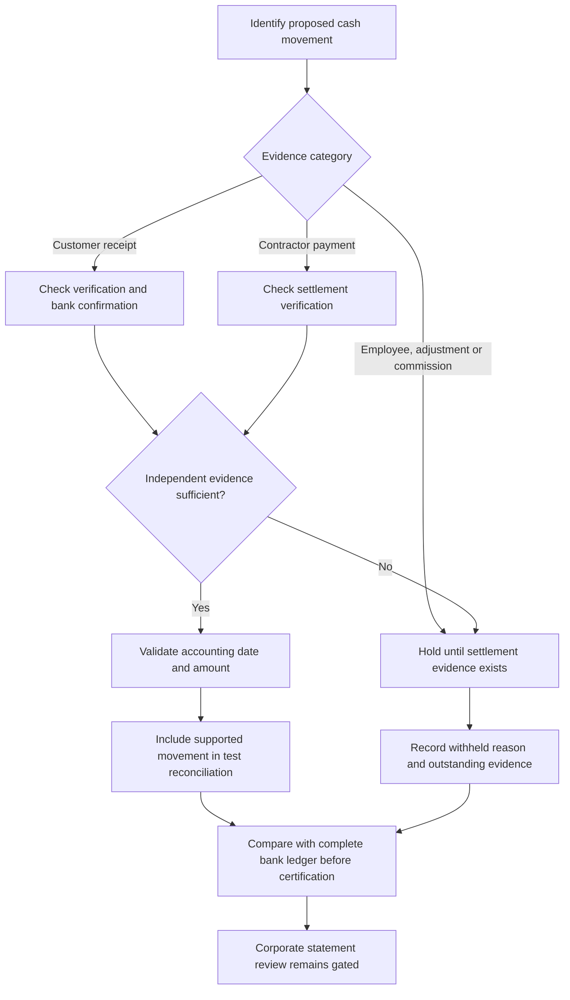

# VERIDIAN Cash Evidence Reconciliation

Checkpoint: 1907P-4419
Status: TEST-ONLY ACCOUNTING FOUNDATION

## Evidence classification

Customer payments require verified payment status plus retained
bank confirmation and independent verification before inclusion
in a synthetic cash receipt total.

Contractor disbursements require a PAID payment record and
independently verified settlement evidence.

Employee payment issuance alone does not establish settlement.
Approved customer refunds and reversals do not establish that
cash moved. Approved commissions do not establish disbursement.

All unsupported movements remain visible as withheld evidence
with a specific explanation. Do not silently count them as cash.

## Financial reconciliation workflow

## Accounting limitations

This isolated component takes fictional evidence dictionaries.
It does not read the actual database, recognize every type of
operational receipt, obtain bank statements, calculate a complete
Balance Sheet, or certify a Cash Flow Statement.

Additional bank, refund, employee settlement and reconciliation
records may be necessary. A complete account of cash requires
bank reconciliation, opening balances and all applicable flows.

The live corporate reporting service and its historical
approved reports remain unchanged. CEO report approval
remains disabled by default pending separate acceptance.
