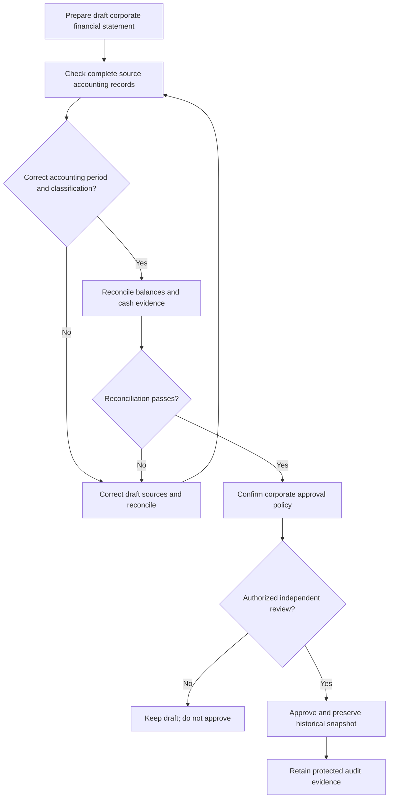

# VERIDIAN Corporate Financial Readiness Controls

Checkpoint: 1907P-4412
Status: Proposed accounting acceptance checks, test-only.

## What the current review established

The existing financial model stores report snapshots, a creator,
an approver, approval date and approval status.

Current tests demonstrate the same Comptroller may create and
approve a corporate financial report.

That behavior is not equivalent to independent approval.

## Proposed accounting review sequence

The proposed independent-review step is NOT yet an approved
corporate financial reporting permission rule.

## Balance Sheet

Assets must equal liabilities plus equity.

This arithmetic check alone does not prove that all accounts,
cash balances, debts or equity records are complete.

## Cash Flow Statement

Actual cash receipts and disbursements must be differentiated
from approved liabilities, proposed payments and recorded
payment statuses that lack independent verification.

The synthetic checker does not verify bank statements.

## Approval responsibility

The corporate statement creator and final approver roles require
separate policy confirmation. Do not modify existing live
permissions based solely on this draft acceptance contract.

## Current development boundary

The Step 4412 Python checker is isolated, synthetic and
database-free. It cannot change, approve or certify reports.

The existing production reporting services, historical
reports, PostgreSQL integrity protections and audit controls
remain unchanged.
