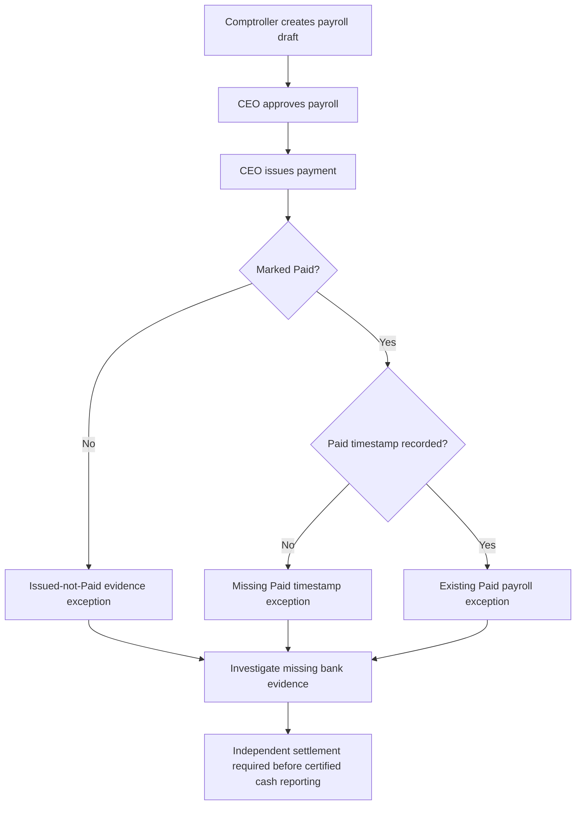

# Payroll Cash Evidence Gaps

Checkpoint: 1907P-4430
Status: Isolated read-only exception supplement.

## What the supplement identifies

An APPROVED payroll record with CEO issuance, but not yet
marked Paid, is flagged for review.

A PAID payroll record with no Paid timestamp is also flagged.
Because it has no cash date, payroll period end is used only
to select a review group, never to establish cash movement.

Payroll already marked Paid with a timestamp remains covered
by the separate Step 4428 evidence-exception report.

## Payroll evidence flow

## Safeguards and limitations

Neither issuance nor Paid status is equivalent to independent
bank settlement.

This supplement is not a complete missing-evidence inventory.
It excludes approved payroll without issuance and other bank
transactions. The report uses operational review dates only.

No existing payroll service, corporate financial calculation,
database migration or historical record is changed. The
corporate CEO approval feature remains disabled by default.
