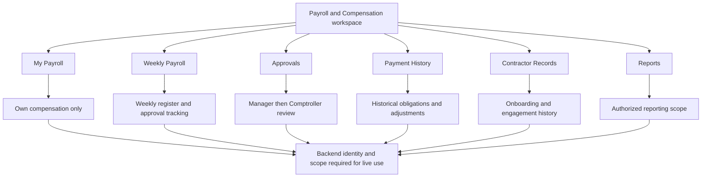
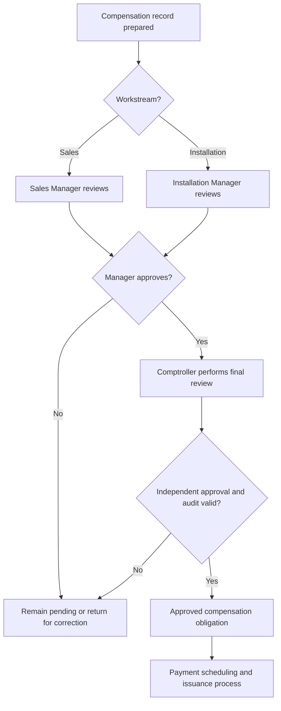
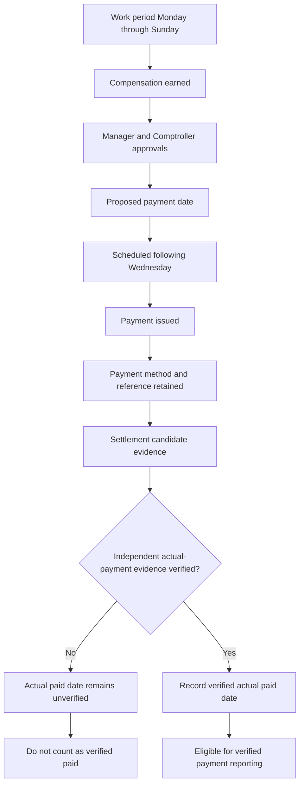
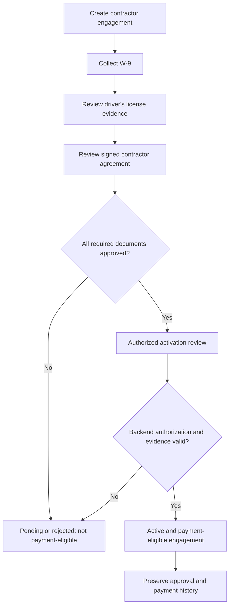
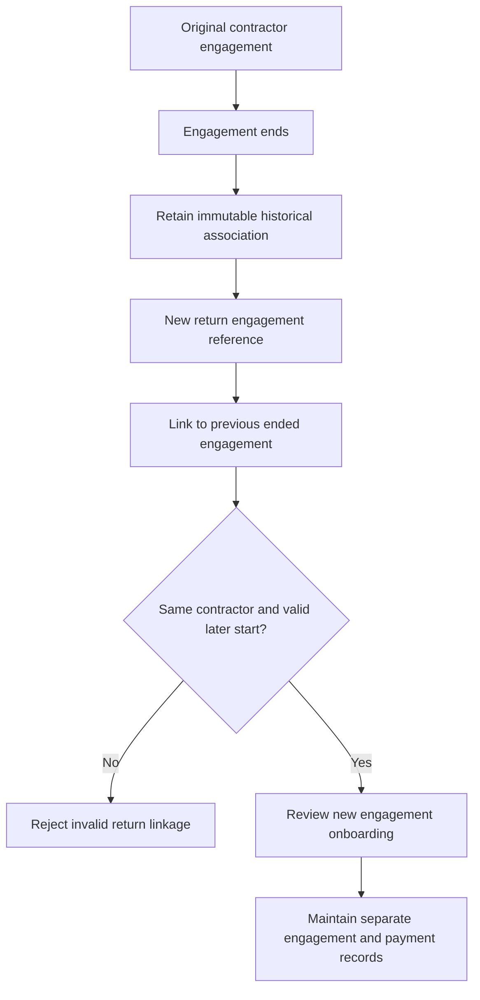
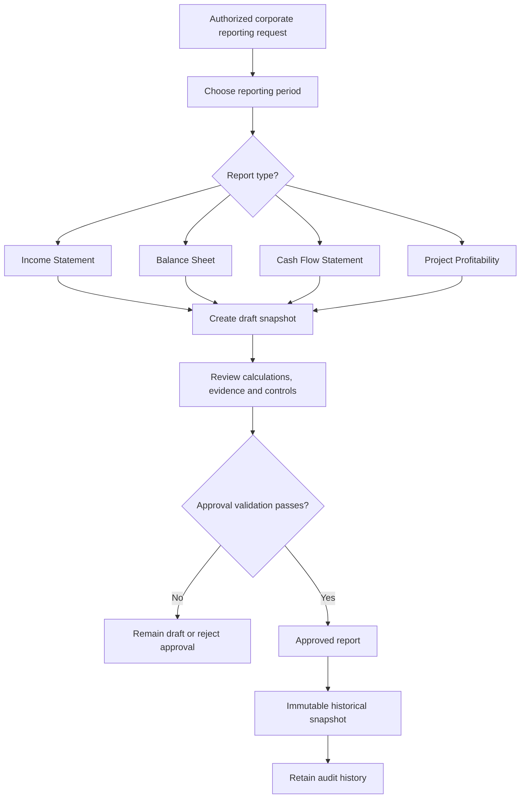
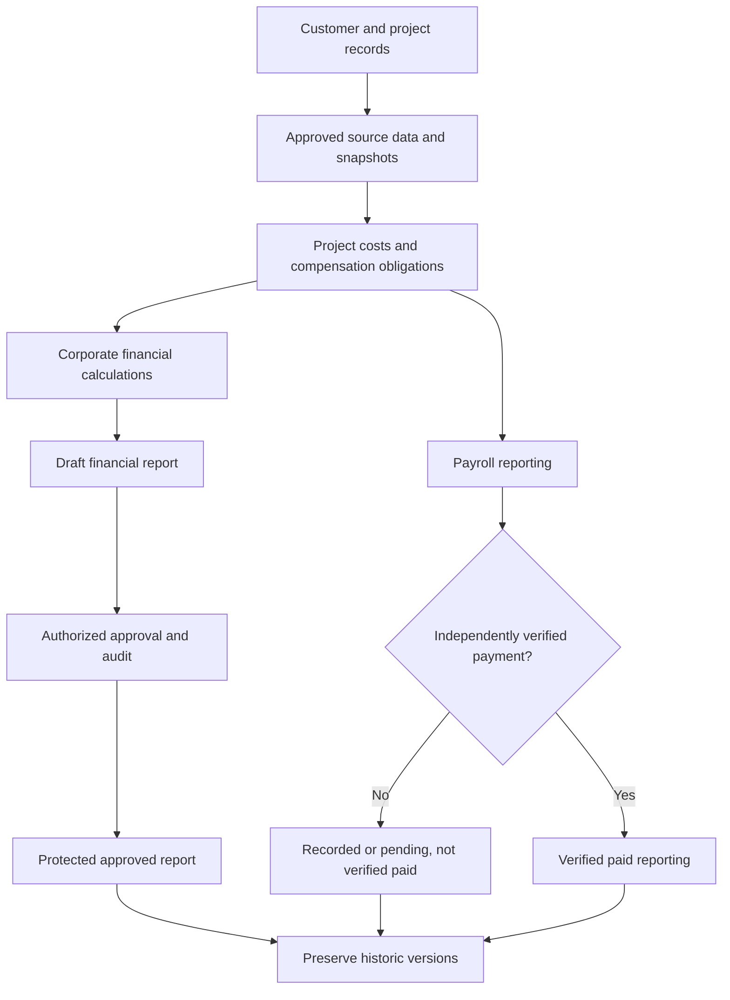
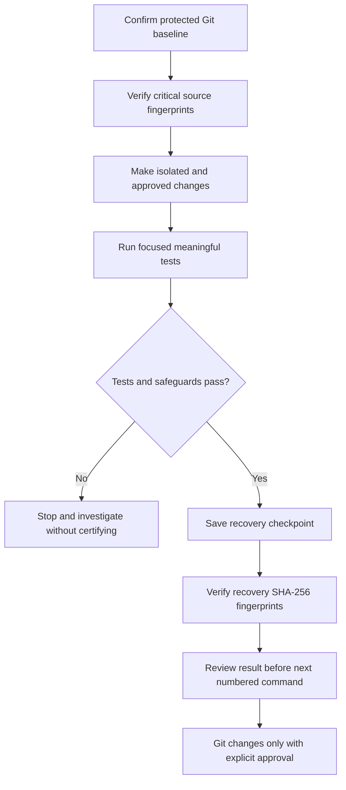

# VERIDIAN User Guide - Process Flowcharts

Document checkpoint: 1907P-4407
System: VERIDIAN Business Operations & Management System
Company: Green Energy Contracting Corporation
Development mode: Isolated previews and protected backend development

## How to read these diagrams

These diagrams explain the intended workflows and the
current development boundaries.

"Approved policy" means a business rule confirmed for VERIDIAN.
"Isolated preview" means fictional presentation data, not live access.
"Backend review required" means production enforcement has not been
established by these presentation tests.

Never use a preview role selector as a real authorization control.
Never interpret recorded payment status as bank-confirmed payment.
Approved historical records must not be silently rewritten.

## 1. Payroll and Compensation workspace

Status: Six-tab fictional React preview accepted.
Real payroll access and payment operations remain disabled.

Role visibility in the preview illustrates approved policy.
Actual personal, manager and company access must be determined
by backend authorization, not by the browser.

## 2. Compensation approval sequence

Status: Approved policy; fictional approval presentation verified.
Operational service integration needs separate review.

No self-approval. Manager and Comptroller responsibilities remain
separate. Durable approval evidence and actual authority must be
verified on the backend.

## 3. Weekly payment evidence and verification

Status: Approved business rules and isolated presentation controls.

A proposed date, scheduled date, issued date or settlement
candidate date is NOT the actual paid date.

The payroll preview currently has no independently verified
actual payment dates. Recorded PAID is not proof of disbursement.

For applicable 1099 reporting, use the legally applicable
payment date, not an invented earned or issuance date.

## 4. Contractor onboarding and eligibility

Status: Approved three-document rule.
Preview shows fictional statuses, not actual document custody.

The browser cannot activate contractors, verify actual
documents, or authorize disbursement.

## 5. Returning contractor engagement history

Status: Approved policy and tested fictional linkage.

Returning contractors do not overwrite prior engagements.
Historical compensation, approvals and adjustments stay separate.

## 6. Corporate financial reporting lifecycle

Status: Existing Django services and API were identified
at Step 1907P-4406. This is a review diagram, not proof
of full production acceptance.

The inspected reporting API is Comptroller-only.
Do not assume a separate second-person approval is implemented
without examining the full service and authorization rules.

The PostgreSQL approval integrity migration includes protections
against altering approved reports. Preserve these safeguards.

## 7. Financial and payroll data boundaries

Status: Design and security guidance.

The Master Sales Record remains the source of truth for
shared customer, project and commercial entries.
Approved MSR versions and signed document snapshots are preserved.

Corporate reporting calculations and payroll reporting must not
silently substitute estimated or unverified figures for actual
financial evidence.

## 8. Development safety and verification workflow

Status: Approved protected batch development practice.

No automatic Git staging, commits or pushes.
Do not target acceptance or operational databases without
specific authorization. Restore tests and recovery verification
must precede production operations.

## Future User Guide work

Add annotated screenshots of each approved interface,
role-based walkthroughs, sample fictional records,
the three-stage Invoice workflow, installation and completion
stage gates, DocuSign evidence checks, and step-by-step
corporate report review once those screens are approved.

This diagram collection is instructional source material.
It does not enable live services or override approved policies.
